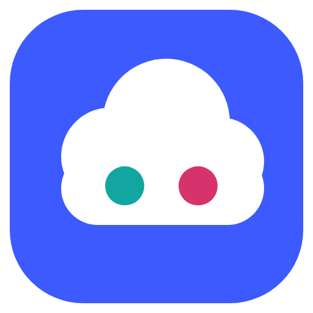
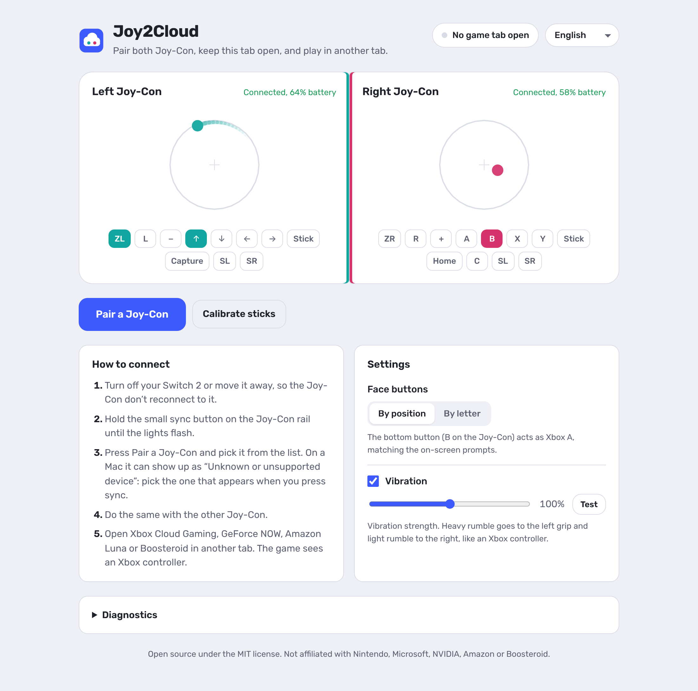

<p align="center">
  
</p>

<h1 align="center">Joy2Cloud</h1>

<p align="center">
  Play cloud games in Chrome with your Nintendo Switch 2 Joy-Con.<br>
  No drivers, no system tweaks: just a browser extension.
</p>

<p align="center">
  <a href="https://chromewebstore.google.com/detail/joy2cloud/jjnpndfledflbabfinlmaiddnfonmdbk"></a>
</p>

<p align="center">
  <picture>
    <source media="(prefers-color-scheme: dark)" srcset="docs/screenshot-dark-en.png">
    
  </picture>
</p>

## Why this exists

I wanted to play Baldur's Gate 3 on Xbox Cloud Gaming on my Mac, and the only
controller I had at hand was the pair of Joy-Con from my Switch 2.

macOS can't use Switch 2 controllers on its own: they talk a proprietary
Bluetooth LE protocol instead of standard HID. The best option I found was
[JoyCon2Mac](https://github.com/OZORDI/JoyCon2Mac), a great native app that
exposes the Joy-Con as a system gamepad. The catch is that it does so through a
DriverKit system extension, and without driver entitlements granted by Apple
it only loads with System Integrity Protection (SIP) and AMFI turned off.
Disabling core macOS security, with a couple of reboots every time, felt like
way too much hassle just to play a game.

Then it clicked: cloud gaming already runs inside the browser. Chrome can talk
to Bluetooth LE devices directly (Web Bluetooth), and games read controllers
through the Gamepad API. So the bridge can live entirely in an extension:
read the Joy-Con over Web Bluetooth, and hand the game a virtual Xbox
controller. Nothing to install on the system, nothing to disable.

## What it does

- Connects both Joy-Con 2 over Bluetooth, straight from Chrome.
- Shows up in the game as an Xbox controller (`standard` Gamepad API mapping).
- Live view of each Joy-Con: stick position with a short trail, and every
  button lighting up as you press it, so you can check everything before you play.
- Stick calibration: reads each Joy-Con's factory calibration, and a guided
  "rotate the stick" calibration records the real edge of your sticks in every
  direction so diagonals reach full tilt.
- Vibration from the game, split like an Xbox controller: heavy rumble on the
  left grip, light rumble on the right. Adjustable strength.
- Face buttons by position (bottom button is Xbox A, matching on-screen
  prompts) or by letter.
- Auto-reconnect for 90 seconds if a Joy-Con drops, and a Disconnect button
  per Joy-Con (or for both) when you're done.
- Dark and light themes, in English, Português, Français and Español.

## Supported sites

| Service | Status |
| --- | --- |
| Xbox Cloud Gaming (xbox.com/play) | Tested |
| GeForce NOW (play.geforcenow.com) | Should work, not tested yet |
| Amazon Luna | Should work, not tested yet |
| Boosteroid | Should work, not tested yet |
| gamepad-tester.com, hardwaretester.com | For testing |

All of them read controllers through the same Gamepad API. If you try one of
the untested ones, please open an issue with how it went.

## Install

**[Add Joy2Cloud to Chrome](https://chromewebstore.google.com/detail/joy2cloud/jjnpndfledflbabfinlmaiddnfonmdbk)** from the Chrome Web Store, then pin it
to the toolbar from the puzzle-piece menu.

<details>
<summary>Install from source instead</summary>

1. Download the latest `joy2cloud-vX.Y.Z.zip` from
   [Releases](../../releases) and unzip it (or clone this repository).
2. Open `chrome://extensions` and turn on **Developer mode** (top right).
3. Click **Load unpacked** and select the `extension` folder.

</details>

Works in Google Chrome and other Chromium browsers with Web Bluetooth enabled.
Safari and Firefox don't support Web Bluetooth.

## Use

1. Turn off your Switch 2 or move it away, so the Joy-Con don't reconnect to it.
2. Click the Joy2Cloud icon. The control tab opens; keep it open while you play.
3. Hold the small sync button on a Joy-Con until the lights flash, press
   **Pair a Joy-Con** and pick it from the list. The first time, macOS asks to
   let Chrome use Bluetooth: allow it.
4. Repeat with the other Joy-Con.
5. Open your cloud gaming site in another tab and play.

**On a Mac**, a Joy-Con may show up in the list as "Unknown or unsupported
device" until Chrome has read its name once. Pick the entry that appears when
you press sync. If you pick the wrong device, the control tab tells you, and
you can try the next one.

**Don't pair the Joy-Con in the macOS Bluetooth settings.** macOS tries a
standard pairing that Switch 2 controllers reject. If you already did, choose
"Forget This Device" there first.

## How it works

```
 Joy-Con (L) ┐                    ┌────────────── game tab ───────────────┐
             ├─ Bluetooth LE ──▶  │ bridge.js ──▶ inject.js               │
 Joy-Con (R) ┘        ▲           │ (content      (overrides              │
                      │           │  script)       navigator.getGamepads) │
            ┌─────────┴────────┐  └───────▲───────────────────────────────┘
            │   control tab    │──────────┘  runtime port: buttons, sticks
            │ hub.js (Web BT)  │◀─────────   ...and vibration back
            └──────────────────┘
```

- `extension/joycon.js` decodes the Joy-Con 2 protocol: input report 0x05
  (buttons, sticks, battery), commands (player LEDs, flash reads), stick
  calibration and rumble packets.
- `extension/hub.js` is the control tab. It owns the Bluetooth connections
  and merges both halves into one gamepad state. It has to be a regular tab:
  Chrome anchors the Bluetooth device chooser to the address bar, and
  extension service workers can't use Web Bluetooth.
- `extension/bridge.js` (content script) relays state between the control tab
  and the game page.
- `extension/inject.js` runs in the page and makes `navigator.getGamepads()`
  return a virtual Xbox controller, including `vibrationActuator`.

Vibration is re-sent with each incoming Joy-Con report rather than on a timer,
because Chrome throttles timers in background tabs to once per second.

## Known limitations

- The control tab must stay open while you play (it can be in the background).
- One player: one pair of Joy-Con per browser.
- Motion controls, the optical mouse sensor and NFC aren't used.
- Vibration is an approximation. The Switch 2 HD rumble format isn't fully
  documented, so effects won't feel like they do on the console.
- On Linux, Web Bluetooth may need `chrome://flags/#enable-experimental-web-platform-features`.

## Development

```
npm install
npx playwright install chromium
npm test
```

The tests decode synthetic packets, simulate sticks with circular and
octagonal edges to check the calibration, and run the extension in a headless
Chromium with fake Joy-Con to check what a game page receives (buttons,
sticks, vibration, calibration, disconnects). `npm run screenshots` renders
the images in `docs/`, `npm run store-assets` the Chrome Web Store images in
`store/`, and `npm run package` builds the release and store zips in `dist/`.

To add a language, copy the `en` block in `extension/i18n.js`, translate it,
add it to `LANGS`, and add a matching `extension/_locales/<code>/messages.json`.

## Credits

Joy2Cloud is new code written for the browser, standing on the shoulders of
people who reverse engineered these controllers:

- **[switch2_controller_research](https://github.com/ndeadly/switch2_controller_research)**
  by ndeadly: the protocol documentation this project is built on (GATT
  characteristics, report layouts, button bits, commands, flash memory map,
  stick calibration location).
- **[JoyCon2Mac](https://github.com/OZORDI/JoyCon2Mac)** by OZORDI and
  contributors, the inspiration for this project. Ported from it: the rumble
  packet encoding, the player LED and connection vibration commands, the
  battery voltage curve, and the idea of resting-center stick calibration.
  MIT licensed; see [NOTICE.md](NOTICE.md).
- **[Switch2-Controllers](https://github.com/Nohzockt/Switch2-Controllers)**
  by Nohzockt, used to cross-check the button layout.
- [League Spartan](https://github.com/theleagueof/league-spartan),
  [Barlow Condensed](https://github.com/jpt/barlow) and
  [Libre Franklin](https://github.com/googlefonts/Libre-Franklin) typefaces,
  SIL Open Font License.

## Privacy

Joy2Cloud collects no data and makes no network requests of its own. See
[PRIVACY.md](PRIVACY.md).

## License

MIT, see [LICENSE](LICENSE).

Nintendo Switch and Joy-Con are trademarks of Nintendo. Xbox is a trademark of
Microsoft. GeForce NOW is a trademark of NVIDIA. Amazon Luna is a trademark of
Amazon. This project is not affiliated with or endorsed by any of them.
